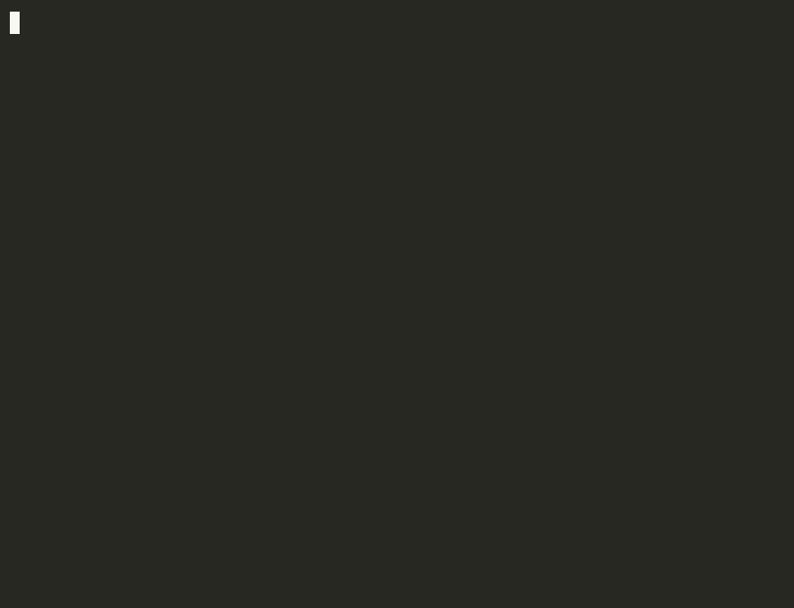

# The Haunted Frog 🐸🎃

**A tiny language model learns Halloween.**

A tiny frog lives inside your terminal. Teach it Halloween words and it starts whispering strange things back.

The frog is [CSE-Frog](https://github.com/kagioneko/cse-frog), a small open-source next-symbol model that you can read end to end.
It is **not** an LLM. It has no attention and no gradient descent, and it only looks back about two symbols.
This project trains it on a 60-line Halloween corpus, lets it speak in a "haunted" terminal, and measures what learning actually changed.

Everything runs locally on a CPU. There are no API keys, no cloud calls and no downloads after `pip install`.



*Recorded with `python -m haunted_frog haunt --count 6 --seed 1003` (asciinema → agg, raw cast in `docs/media/haunt.cast`). Every 🐸 line is model output. Run the same command to get the same lines.*

A second real run, as plain text:

```text
[ HAUNTED FROG TERMINAL ]

        _   _
       (o)-(o)
    .-(   "   )-.
   /   '-----'   \
   \_/ \_____/ \_/

A strange presence has awakened...
(model: cse-frog 0.2.0, word-level, 60 lines x 5 epochs, session seed 31)

🐸 THE FROG   [seed 31]
🐸 THE FROG   [seed 32]
🐸 THE HOUSE   [seed 33]
...the cursor blinks on its own...
🐸 THE LIGHT   [seed 34]
...the cursor blinks on its own...
🐸 THE VAMPIRE IS FLICKERING   [seed 35]
🐸 THE NIGHT   [seed 36]
🐸 THE FROG IS ROLLING IN THE LIGHT IS BUBBLING   [seed 37]
...the cursor blinks on its own...
🐸 THE MACHINE   [seed 38]

The frog is still watching.
```

This is a real, unedited run (`python -m haunted_frog haunt --fast --count 8 --seed 31`).
Two kinds of text are kept apart on purpose:

- **🐸 lines** (bright green) are real CSE-Frog output, printed verbatim. The seed is shown next to each line, so you can reproduce it.
- **Dim lines** without a frog ("A strange presence has awakened...", "...the cursor blinks on its own...") are fixed, hand-written narration. The model never wrote them.

## Quick start

Requires Python 3.10+.

```bash
git clone https://github.com/kagioneko/the-haunted-frog
cd the-haunted-frog
python -m venv .venv && source .venv/bin/activate
pip install -e ".[test]"

python -m haunted_frog train              # word-level frog, 5 epochs -> models/
python -m haunted_frog haunt              # open the Haunted Terminal (Ctrl+C to leave)
python -m haunted_frog evaluate           # before/after experiment -> results/
```

Use `pip install -e .` from the cloned repo. The corpus files live in `data/` next to the package and are read from there.

### Commands

| Command | What it does |
|---|---|
| `train [--unit word\|char] [--epochs N] [--corpus FILE] [--top-k-edges K] [--temperature T]` | Train a new frog and save it to `models/frog-<unit>.cse` (CSE-Frog's own JSON format, no pickle) together with a metadata file. The metadata records the corpus hash, epochs, settings and cse-frog version. |
| `haunt [--unit ...] [--seed S] [--count N] [--prompt "THE GHOST"] [--fast] [--no-halloween] [--log FILE]` | The Haunted Terminal. Line *i* uses seed `S+i`, so a whole session can be replayed. `--count 0` speaks forever. `--no-halloween` turns off colours and narration. |
| `generate [-n N] [--seed S] [--max-len L] [--prompt ...] [--log FILE]` | Raw output: one `seed<TAB>text` per line. |
| `evaluate [--seeds 100] [--first-seed 1000]` | Runs the experiment below and writes `results/experiment.json` and `.md`. |

Prompts can only use words (or, for `--unit char`, letters) that appear in the corpus. The frog refuses symbols it has never seen.

### Teach it your own Halloween

Edit `data/halloween.txt`: one phrase per line, with `#` for comments. Then run `train` again.
Every line is learned as its own sequence, so the frog learns where phrases end.

> **Gotcha we hit:** if you pass CSE-Frog a *flat* list of strings, it treats the whole list as **one** sequence with one symbol per string.
> Our first attempt therefore learned 60 phrase-sized "symbols" and recited the corpus as one run-on sentence (`HAPPY HALLOWEENTRICK OR TREATGHOST IN THE MACHINE...`).
> The fix is to pass a list of lists (`haunted_frog/corpus.py: to_sequences`), and `tests/test_training.py` checks it.

## What the frog actually learned

The full method and every number are in [docs/EXPERIMENT.md](docs/EXPERIMENT.md).
The raw output is in [results/example_results.json](results/example_results.json).

Each condition is scored on 100 seeds (1000-1099) with the same metrics.
Word-level conditions use `top_k_edges=16` unless they are marked k3.

| Condition | Halloween words | Novel lines | Unique outputs | Mean words |
|---|---|---|---|---|
| Untrained `Frog()` | — (silent: 100% empty) | — | — | 0 |
| Control corpus (everyday words), word | 0.0 | 0.95 | 0.59 | 3.63 |
| Halloween, word, 1 epoch | 0.18 | 0.83 | 0.81 | 4.17 |
| Halloween, word, 5 epochs | 0.15 | 0.91 | 0.57 | 3.68 |
| Halloween, word, 20 epochs | 0.19 | 0.94 | 0.38 | 2.99 |
| Halloween, word, 5 epochs, CSE-Frog default k=3 | 0.15 | 0.80 | 0.20 | 3.13 |
| Halloween, **char**, 5 epochs | **0.0** | 1.0 | 0.92 | 9.42 |

What worked:

- **Learning changes what it says.** The untrained frog is silent and rejects every word. The control frog never says a Halloween word. The Halloween frog uses one in every 5-7 words.
- **It recombines.** Most word-level lines are not copies of corpus lines. Examples: `THE ZOMBIE IS FLICKERING`, `THE GHOST IS IN THE FROG`, `THE OWL SAYS WHO IS THERE`.

What failed or surprised us:

- **It over-uses "THE".** Almost every word-level line starts with `THE`, and the Halloween-word rate (15-19%) stays *below* the corpus's own 22.6%.
- **More training made it less varied.** With more epochs, unique outputs fell from 81% to 38%, and the frog fell back on a few attractors such as `THE GHOST` and `THE MACHINE`.
- **CSE-Frog's default `top_k_edges=3` is too narrow for this corpus.** Unique outputs were only 20%, and nearly every line started with `THE GHOST`, `THE MACHINE` or `THE FROG`. We raised it to 16 after looking at seeds 0-39 and then scored on seeds 1000+.
- **The character-level frog never produced a single Halloween word.** It spins in an `IN IN ING` loop (`THE INGHE INGHE IN IN IN THE ING`) with occasional fragments like `AUNIGIC`. With only about two symbols of context it cannot hold a word together. This is the clearest picture of why real LMs need longer context.
- "Novel" only means "not an exact corpus line". It does not mean grammatical: `THE FROG IS ROLLING IN THE LIGHT IS BUBBLING`.

## How it works

```text
data/halloween.txt ──read_lines──> 60 phrases ──to_sequences──> [["THE","GHOST",...], ...]
                                                                  │
                                                       cse.Frog(top_k_edges=16).learn(epochs=5)
                                                                  │
                                         models/frog-word.cse + frog-word.json (metadata)
                                                                  │
                         frog.generate(prefix, n=max_len, seed=s)  ──> stops at <END> or max_len
                                                                  │
                     haunt: print verbatim in green + seed  |  evaluate: score 100 seeds per condition
```

All of the learning and prediction happens inside CSE-Frog.
This repo supplies the corpus, the training and generation plumbing, the terminal and the evaluation.
See [docs/ARCHITECTURE.md](docs/ARCHITECTURE.md).

## Limitations

- This is a teaching-sized model. It recombines short phrases. It does not understand English, hold a conversation or know what Halloween is.
- Context is roughly the last two symbols, so long outputs drift (`... IN THE LIGHT IS BUBBLING`).
- Character-level generation is mostly non-words.
- The metrics are simple surface counts on 100 samples per condition. They are not significance tests.
- The vocabulary is fixed by the corpus. Prompts with unseen words are rejected rather than guessed.

## Credits and license

- **CSE-Frog** (the model engine) by Emilia Lab / Kagino Neko, MIT License: https://github.com/kagioneko/cse-frog · https://pypi.org/project/cse-frog/. It is used as an unmodified PyPI dependency (`cse-frog==0.2.0`). No CSE-Frog source is copied into this repository. See [NOTICE.md](NOTICE.md).
- **The Haunted Frog** was created during Hacktoberfest 2026 (Week 4, "Ghost in the Machine"), starting 2026-10-29.
- The corpus, control corpus and lexicon were written for this project.
- The code was written with AI coding assistance (Claude Code), then run and tested locally.
- MIT License. See [LICENSE](LICENSE).
